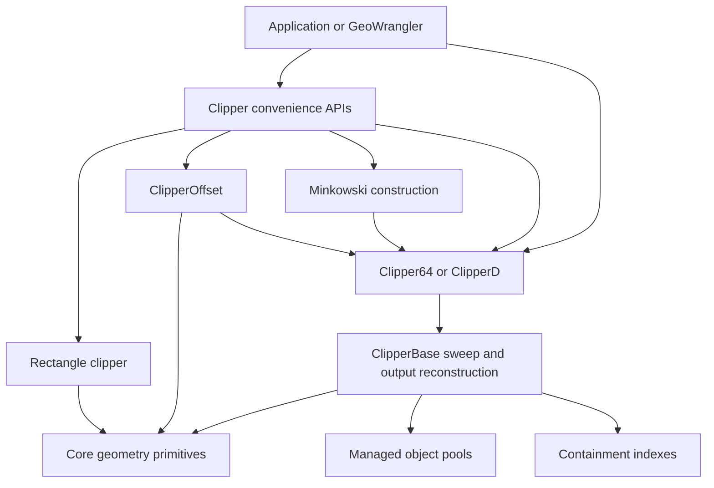

# Developing Clipper2: from geometric ideas to cooperating source code

This companion to [Understanding Clipper2](GUIDE.md) explains how to read, debug, and modify this repository's C# implementation. It assumes basic programming knowledge, but no background in computational geometry. The goal is to connect a visible geometric result to the methods and state that produced it.

Read sections 1–4 before stepping through the engine. Sections 5–10 explain its cooperating subsystems. Sections 11–14 connect those subsystems to DesignLibs, debugging, and maintenance. The [upstream maintenance record](upstream/README.md) identifies the native revision and deliberate local compatibility choices. Method names below refer to this maintained port, not every historical Clipper release.

## 1. Start with the problem, not the linked lists

A polygon boundary is a sequence of straight segments. A *region* is the filled space those boundaries describe. One boundary can surround material; another can surround an empty hole. An *open path* is a line or polyline without an implied final segment back to its start.

A Boolean operation asks which parts of the plane satisfy a rule:

| Operation | Keep a location when… |
| --- | --- |
| Intersection | it is in both subject and clip |
| Union | it is in either subject or clip |
| Difference | it is in subject and outside clip |
| Exclusive-or | it is in exactly one of them |

“Inside” itself needs a rule when boundaries overlap or cross themselves. A *fill rule* interprets boundary crossings. EvenOdd toggles inside/outside at each crossing; NonZero adds signed crossings and treats a nonzero total as inside. Positive and Negative select the sign of that total. The [fill-rule chapter](GUIDE.md#4-filling-a-boundary-parity-winding-and-orientation) develops this further.

The library must answer two related questions:

1. **Classification:** on which side of a boundary does the requested result contain material?
2. **Construction:** where do result boundaries meet, and how should their pieces be connected?

Classification alone cannot produce a path. Computing all crossing coordinates alone cannot determine which pieces belong in the answer. The engine maintains both answers together.

An offset asks a different question: where is a boundary a given distance from the input? It constructs candidate segments and corners, then uses a Boolean union to turn them into valid regions. This is the first major example of modules cooperating.

## 2. A map of the implementation

Follow an operation from its entry point rather than reading every file in directory order.

| Source | Responsibility | Read it when… |
| --- | --- | --- |
| [Clipper.cs](Clipper.cs) | Convenience APIs, conversions, area, bounds, simplification, tree flattening | choosing an API or finding hidden scaling/defaults |
| [Clipper.Core.cs](Clipper.Core.cs) | Points, paths, enums, low-level geometric tests and constructions | investigating signs, precision, intersections, or data representation |
| [Clipper.Engine.cs](Clipper.Engine.cs) | Input preparation, sweep, winding, intersections, output rings, trees; `Clipper64` and `ClipperD` | understanding general Boolean operations |
| [Clipper.Offset.cs](Clipper.Offset.cs) | Offset groups, normals, corner/cap generation, finishing union | investigating growth, erosion, or strokes |
| [Clipper.RectClip.cs](Clipper.RectClip.cs) | Specialized axis-aligned rectangle clipping | debugging `RectClip` or `RectClipLines` |
| [Clipper.Minkowski.cs](Clipper.Minkowski.cs) | Translated patterns and connecting quadrilaterals, followed by union | understanding Minkowski sum/difference |
| [Clipper.Index.cs](Clipper.Index.cs) | Spatial indexes for repeated geometry/containment work | investigating ownership-query performance |
| [PooledList.cs](PooledList.cs) | Reusable internal vertices and output objects | changing object fields or investigating reuse bugs |
| [Clipper.Helper.cs](Clipper.Helper.cs) | Repository helper extensions | following local conveniences beyond upstream APIs |



Arrows indicate calls or supporting services, not ownership. Rectangle clipping does not take a detour through the general sweep. `ClipperD` does use the same integer sweep as `Clipper64`. Static convenience methods usually create instances for you; they do not establish a global configuration.

## 3. Geometry vocabulary translated into code

### Edges, direction, and orientation

A directed segment from A to B has vector `(B.X − A.X, B.Y − A.Y)`. Its direction describes travel along the path. It is different from the direction the sweep traverses that segment.

For two vectors, the two-dimensional cross product is `ax * by − ay * bx`. Its sign says which way one vector turns toward the other; zero means they are parallel. Applied to vectors AB and AC, it tests which side of line AB contains C. This is an *orientation predicate*: a discrete decision, rather than a newly generated coordinate.

For A=(0,0), B=(10,0), C=(5,3), the determinant is 30. Moving C below the line changes the sign. Screen displays often increase Y downwards, so visual “clockwise” language can be misleading. Use signed area and the library's conventions when inspecting actual data.

A *construction* creates a point, for example the intersection of two lines. Segments (0,0)–(3,3) and (0,3)–(3,0) meet at (1.5,1.5). Integer output cannot represent that point exactly. The local compatibility policy influences how such intersections reach the grid. A mathematically correct sign test and a rounded constructed point can therefore require different arithmetic.

Do not replace an exact predicate with a floating-point epsilon merely because nearby construction code uses doubles. The predicate controls connectivity. A wrong sign can join the wrong rings, not just move a vertex slightly.

### Events, scanlines, and scanbeams

Imagine a horizontal line sweeping from larger Y toward smaller Y. A *scanline* is a height at which the engine handles an event. A *scanbeam* is the strip between consecutive heights. A *local minimum* starts sweep bounds; in this implementation it is encountered at the larger-Y end of those bounds. The name describes the algorithm's convention, not necessarily the numerical minimum of Y.

An *active edge* crosses the current sweep position. The active edge list (**AEL**) orders these edges from left to right. Inside/outside state can be determined by walking these crossings. At a crossing between edges their order changes; at a vertex an edge advances to its next segment or ends.

A *horizontal edge* lies on an event height rather than crossing the strip. Its handling must account for overlaps and several events sharing that height. That is why the implementation cannot treat every segment with one generic slope formula.

## 4. Trace a complete Boolean request

Use this small example as a debugging exercise. It intentionally selects compatibility explicitly.

```csharp
using System;
using Clipper2Lib;

Path64 subject = Clipper.MakePath(new long[]
    { 0,0, 100,0, 100,100, 0,100 });
Path64 clip = Clipper.MakePath(new long[]
    { 50,50, 150,50, 150,150, 50,150 });

var engine = new Clipper64
{
    Compatibility = ClipperCompatibility.Upstream
};
engine.AddSubject(subject);
engine.AddClip(clip);
var result = new Paths64();
if (!engine.Execute(ClipType.Intersection, FillRule.NonZero, result))
    throw new InvalidOperationException("Clipping failed.");
Console.WriteLine(Clipper.Area(result)); // 2500
```

The overlap is the square from (50,50) to (100,100). Its boundary can start at any corner. Its list position is not an application identity.

### Stage A: turn lists into prepared input

`AddSubject` and `AddClip` eventually reach `ClipperBase.AddPaths`, which calls `ClipperEngine.AddPathsToVertexList`. The engine prepares linked `Vertex` objects, identifies local minima, and records whether each path is subject/clip and open/closed.

At this point no Boolean operation has executed. Input preparation describes possible events. It does not yet know whether the caller will request intersection or union.

The prepared vertices are internal objects. Do not model them as a live view of the caller's `Path64`, or expect changing a caller list after addition to update them. To change the input, clear and add the revised geometry.

### Stage B: select the operation and sweep

`Clipper64.Execute` clears the caller's solution, enters a `try` block, and calls `ExecuteInternal`. `Reset` orders minima by descending Y and ascending X. `PopScanline` combines pending minima heights with queued edge-top heights; `InsertLocalMinimaIntoAEL` consumes minima at the selected height.

The orchestration in `ExecuteInternal` is:

```text
select operation and fill rule; Reset
obtain first event height
repeat while successful:
    insert bounds starting at this height
    process queued horizontals
    convert recorded horizontal segments into pending joins
    record bottom of the next scanbeam
    obtain next event height, or finish
    find and process intersections inside the scanbeam
    advance/remove edges at the top of the scanbeam
    process newly encountered horizontals
finish pending horizontal joins
```

This outline follows the method's order, but omits branch details. For the rectangle example, horizontal edges make up much of the work. Do not expect every corner to pass through the general intersection-list machinery.

### Stage C: extract output, then release temporary state

For flat output, `BuildPaths` cleans closed output rings and copies them into public paths. For tree output, `BuildTree` also establishes containment relationships. These are alternative extraction routes over the sweep result.

`Execute` catches exceptions, marks failure, and returns a Boolean. Its `finally` block calls `ClearSolutionOnly`. A false result must not be interpreted as a successful empty intersection; discard any partial output. During debugging, break on thrown exceptions to see their original location before the public wrapper catches them.

`ClearSolutionOnly` removes temporary execution state while retaining prepared input. Another `Execute` can use that input with a different operation. `Clear` also removes the prepared input. See section 10 for reuse implications.

## 5. The three graphs you must keep separate

The engine contains several linked structures because they answer different questions.

| Structure | Objects and links | Meaning |
| --- | --- | --- |
| Prepared input | `Vertex.next`, `Vertex.prev`; `LocalMinima.vertex` | where the original path goes and where its bounds start |
| Current sweep | `Active.prevInAEL`, `nextInAEL`; temporary SEL links | which edges are adjacent at the sweep position |
| Constructed output | `OutPt.next`, `prev`; `OutRec.pts` and `owner` | how result boundary pieces connect and which contour contains another |

Input adjacency does not imply output adjacency. At an intersection, the result can follow part of one input path and continue along another. Likewise, AEL neighbors can belong to unrelated output contours.

### Important `Active` fields

| Field | Interpretation |
| --- | --- |
| `bot`, `top` | endpoints of the current segment in sweep order |
| `curX` | X position used at the current stage of sweep processing |
| `dx` | change in X per change in Y, with special horizontal handling |
| `vertexTop` | prepared input vertex reached at the segment's top |
| `windDx` | signed crossing contribution from this bound |
| `windCount` | winding information for its own subject/clip category |
| `windCount2` | winding information for the other category |
| `outrec` | associated output record when this edge is contributing |
| `localMin` | provenance and open/closed classification of this bound |
| `joinWith` | participation in a pending adjacent-edge join |

A *hot* edge has an output association (`IsHotEdge`). It does not mean “inside both operands.” Whether an edge contributes depends on the operation, fill rule, winding state, and open/closed status.

The **SEL**, or sorted edge list, is working storage used to reason about changed order. Its links and `_sel` are also reused for horizontal processing. Read them at a known program phase; there is no permanent second copy of the input graph.

### Important `OutRec` fields

`pts` anchors a circular `OutPt` ring. `frontEdge` and `backEdge` identify active ends while that contour is being built. `owner` records provisional containment or redirects through merged records. `splits` helps resolve ownership after a contour splits. `path`, `bounds`, and `pipIndex` support extraction and containment queries.

An `OutRec` with no live ring can still participate in bookkeeping. Removing it because `pts` is null can destroy a redirection or split-ownership relationship.

## 6. How edges become result contours

### Starting a bound: insertion, winding, contribution

`InsertLocalMinimaIntoAEL` creates active bounds, computes slopes, and inserts them into AEL order. `SetWindCountForClosedPathEdge` or `SetWindCountForOpenPathEdge` initializes the appropriate classification state. `IsContributingClosed` and `IsContributingOpen` decide whether output begins there.

For a contributing closed start, `AddLocalMinPoly` allocates an `OutRec`, attaches its active ends, establishes provisional ownership, and creates the first output point. Open paths use their own start logic. Input traversal sign (`windDx`) and the front/back direction of output construction serve different purposes; do not make one a substitute for the other.

### Advancing a boundary

`AddOutPt` attaches a point to the appropriate end of the output ring, suppressing duplicate endpoint coordinates. Both active ends can extend the same record. This permits the sweep to construct a closed boundary incrementally without knowing all its future intersections.

`UpdateEdgeIntoAEL` advances an active edge along its prepared vertices. It also handles shared-vertex ordering and adjacent joins. A change that merely updates `top` but skips these side effects can leave geometrically plausible coordinates with incorrect topology.

### Crossing: classification and connectivity change together

`BuildIntersectList` calls `AdjustCurrXAndCopyToSEL` to compare current order with order at the top of the scanbeam. When edges reverse their relative order, their segments cross. A stable linked merge discovers the required crossings; an already-sorted fast path avoids unnecessary work.

`AddNewIntersectNode` constructs an intersection using `InternalClipper.GetLineIntersectPt`, with compatibility-dependent calculations, then constrains it to the scanbeam as necessary. This constraint matters because rounded intersections can otherwise be handled outside the strip in which their event belongs.

`ProcessIntersectList` orders intersection events and ensures the relevant edges are adjacent before processing. It calls `IntersectEdges`, swaps AEL positions, and checks adjacent joins. `IntersectEdges` updates winding/contribution and output connectivity. Swapping the AEL links alone is insufficient.

Consider crossing diagonals (0,0)–(100,100) and (0,100)–(100,0). At Y=75 their X positions are 75 and 25; at Y=25 they are 25 and 75. Their order reverses at (50,50). This explains intersection discovery, but is not a full Boolean example: the surrounding closed boundaries determine which output branches continue through that point.

### Ending or joining contours

`AddLocalMaxPoly` handles meeting output ends. It may close a ring or join records. `JoinOutrecPaths` splices circular lists and leaves ownership/redirection information for the merged record.

Horizontal overlap joins are collected and finalized through dedicated processing, including `ConvertHorzSegsToJoins` and `ProcessHorzJoins`. This delayed work is part of the algorithm, not redundant cleanup. Shared segments need more information than a single isolated crossing supplies.

These operations resemble editing a railway junction: coordinates locate the junction, winding decides which tracks are useful, and ring links determine where a traveler goes next. A correct junction coordinate with incorrect links still gives the wrong route.

## 7. Cleanup, holes, and ownership

A sweep result is not immediately a tidy list of user paths. It can contain collinear points, collapsed pieces, or small self-intersections introduced by integer construction.

`CleanCollinear`, `FixSelfIntersects`, and `DoSplitOp` repair output as needed. `BuildPaths` iterates a potentially growing output-record collection because cleanup can create additional records. Capturing the initial count for an optimization can silently omit those results.

For a `PolyTree`, `CheckBounds` obtains a cleaned path and its bounding box. `RecursiveCheckOwners` resolves containment. A bounding box can reject impossible containment cheaply, but overlapping boxes do not prove containment: two crescent-shaped regions can have similar boxes and no nesting.

`Path1InsideOwner` uses point-in-polygon reasoning. With sufficiently large owner paths, it can use a `StripeIndex`; `PipIndexThreshold` selects that route. Points on boundaries are ambiguous evidence, so fallback work is needed. A containment test must distinguish *on the boundary* from *strictly inside*.

Split records complicate ownership further. `CheckSplitOwner` traverses split relationships and guards recursive traversal. Preserve those guards when porting ownership fixes: a cycle can produce a stack overflow even if every individual polygon looks reasonable.

A tree's root is a container, followed by alternating outer/hole/island levels. A hole is a relationship, not “path number 1.” Flattening the tree discards that explicit relationship. Reordering a flat list cannot recreate it reliably.

## 8. `ClipperD`: double input, integer decisions

`ClipperD` is a conversion layer over the same base engine. Its `AddPaths` scales `PathsD` with `Clipper.ScalePaths64`. Output is de-scaled after integer extraction. Decimal precision p corresponds to grid spacing approximately `10^-p` in application coordinates; p is restricted to −8 through 8.

At precision 2, input coordinates 1.234 and 1.233 can reach the same grid coordinate. After this collapse no later engine method can recover their original separation. This is quantization, not a winding error.

Follow units across every boundary:

```text
application doubles
    -> multiply by scale and round to integer grid
    -> prepare vertices and run integer sweep
    -> extract integer paths
    -> multiply by inverse scale
    -> application doubles
```

Greater precision preserves smaller features but uses more of the available coordinate range. Choose a grid from the smallest meaningful feature and largest expected design extent. Do not tune precision solely until one failing design passes.

With `USINGZ`, X/Y determine geometry; Z carries metadata. `ClipperD` wraps the callback so it receives de-scaled coordinates and copies metadata back. Debug the wrapper as well as the base engine if callback units seem wrong.

## 9. Offsetting: construction followed by classification

### Normals, joins, and caps without prior geometry knowledge

A *unit normal* is a vector of length one perpendicular to a segment. Multiplying it by offset distance delta gives a displacement to a parallel segment. Each segment has two possible normals; direction and group orientation determine the relevant side.

Adjacent displaced segments need a connection:

- A miter extends them to their intersection. At a sharp angle this can create a very long spike; `MiterLimit` bounds that behavior.
- A bevel connects cut-off corners with a straight segment.
- A square join uses the library's square-corner construction.
- A round join approximates an arc with short segments. `ArcTolerance` influences the approximation.

An open stroke also needs ends, called *caps*. `EndType` determines whether input represents a polygon, a joined line, or an open line with a particular cap. A closed polygon offset and a closed stroked line describe different regions.

### Source-level call chain

`AddPaths` creates a `Group`, strips duplicates, and records join/end styles. Group orientation analysis uses signed areas and identifies relevant outer contours and stray paths.

`ExecuteInternal` then:

1. Calls `SetGroupOrientations`.
2. For `abs(delta) < 0.5`, copies eligible polygon boundaries; otherwise calls `DoGroupOffset` for each group.
3. Builds per-path normals and dispatches to `OffsetPolygon`, `OffsetOpenJoined`, or `OffsetOpenPath`.
4. Uses `OffsetPoint` and corner routines to generate candidate boundaries.
5. Creates a finishing `Clipper64` through `InitClipper` and runs a Positive-fill union into flat output or a tree.

The tiny-delta route still reaches cleanup union when candidate paths exist; it is not an unconditional identity operation. Open strokes disappear on that route.

Why union? Displaced corners can overlap. Shrinking can collapse a narrow neck and split a region; growing can merge neighboring regions. Candidate generation does not establish a final topologically valid answer. The finishing sweep resolves those overlaps and connectivity changes.

`InitClipper` propagates `PreserveCollinear`, `Compatibility`, and Z handling. The finishing clipper's output reversal combines `ReverseSolution` with the selected input-orientation policy. Changing a setting only in the construction stage can therefore leave the finishing stage inconsistent.

`PreserveInputOrientation` follows compatibility unless explicitly assigned. Legacy defaults to retaining the first polygon group's input direction; Upstream defaults to positive outer output. `ReverseSolution` reverses the selected policy. These settings influence downstream code that infers holes from signed area.

### Mutable per-path state

`DoGroupOffset` processes paths within a group, but some decisions belong to an individual path. For example, a two-point joined path needs cap treatment without changing the end type used for later paths. Normals must be rebuilt even for degenerate cases. Delta callbacks can alter local distance and require corresponding round-step updates.

When a bug appears only after a certain preceding path, inspect per-path state and initialization before changing geometry formulas.

`ClipperOffset.Execute` returns `void`, unlike the Boolean engine. Callback exceptions can propagate. Its flat output is also used as candidate working storage before the finishing union. Do not treat either operation's failed output as usable geometry.

## 10. Object lifetime, caches, and repeat execution

There are three lifetimes to reason about:

| Lifetime | Examples | Reset boundary |
| --- | --- | --- |
| Added input | prepared vertices and minima | `Clear` or replacing the instance |
| One execution | active edges, intersections, output rings, output ownership/index caches | `ClearSolutionOnly` after extraction or failure |
| Reusable capacity | allocated pool objects and backing storage | retained for reuse, subject to pool implementation |

Pooling reduces allocation pressure. It also means constructors do not necessarily run when an object becomes active again. `VertexPoolList.Add`, `OutPtPoolList.Add`, and `OutRecPoolList.Add` explicitly initialize reused objects.

When adding an `OutRec` field, inspect its declaration, first construction, pooled reuse, and pool clearing. In particular, a stale `pipIndex`, `owner`, or `splits` relationship can make a new operation consult geometry from an earlier one. A single fresh-instance regression test may never expose that bug.

Output `Path64` lists are extracted public data, not the temporary `OutPt` nodes. Do not publish internal nodes to application code or retain references to them across execution.

Standalone spatial indexes also represent a snapshot. Rebuild them after changing indexed geometry. An index is an acceleration mechanism, not permission to change boundary semantics. Compare indexed and unindexed behavior on difficult shared-boundary cases.

Use separate engine instances for concurrent operations. An instance's sweep state, output targets, and pools are mutable. A callback should not re-enter the same instance and start another operation.

## 11. How DesignLibs adds application meaning

The application pipeline is often longer than “call Clipper.” Read wrappers with the same care as the engine, especially when protecting Variance and Quilt behavior.

### Layer Boolean operations

In [GeoWrangler's Boolean wrapper](../geoWrangler/boolean.cs), the simple `LayerBoolean` overload reaches `pLayerBoolean`, constructs `ClipperD` with `Constants.roundingDecimalPrecision`, sets `PreserveCollinear`, adds operands, maps AND/OR to Intersection/Union with EvenOdd fill, and reorders output coordinates through `reOrderXY`.

The overload with layer operators also implements tone inversion and short-circuit handling before that call. The more elaborate `customBoolean` route includes fragmentation, gap/sliver processing, closure, hole detection, and keyhole conversion around its Boolean work.

These steps express domain policy. Fragmentation adds vertices for later processing. Gap treatment can create new geometry. A *keyhole* represents a hole by connecting it to an outer boundary through a narrow channel, which is different from retaining an explicit tree relationship.

Consequently, a difference in final output can arise before clipping, in clipping, or after clipping. Capture geometry at those boundaries. A correct core intersection does not by itself prove a correct application design.

The simple wrapper currently does not inspect the Boolean returned by `Execute`. When diagnosing an empty application result, check the engine return value under a debugger as well as the wrapper's returned path count.

### The local `inflatePath` unit contract

In [inflate.cs](../geoWrangler/inflate.cs), `GeoWrangler.inflatePath(PathD, int)` is a specialized wrapper:

```text
source doubles -> scale coordinates by 100
               -> ClipperOffset, Miter joins, Square ends
               -> Execute(width), deliberately without scaling width
               -> take output[0], scale coordinates by 0.01
               -> reorder and close
```

Thus an offset delta of `width` represents `width / 100` in source-coordinate distance. It is a stroke-style call, not the same operation as a closed-polygon offset of `width` source units. It returns only the first output path and assumes that output exists. These are existing wrapper contracts to understand before refactoring, not general guarantees from Clipper.

`resize` in that file multiplies coordinates. Scaling enlarges a shape relative to an origin or pivot; offsetting moves boundaries by distance. They coincide for some simple shapes only under specially chosen parameters.

### Compatibility belongs to the whole pipeline

Static facade operations and these default-constructed local instances use Legacy compatibility. Setting Upstream on a different engine does not propagate through unrelated wrappers or through Minkowski convenience calls.

A migration must account for every operation in a pipeline, its units, rounding, winding assumptions, and postprocessing. Keep the existing application expectations while testing a proposed migration against representative designs. Do not rewrite expected coordinates merely because the new result looks equally plausible.

## 12. Debugging by symptom and state boundary

Begin with the smallest reproducible input, operation, fill rule, precision, compatibility, and settings. Preserve point order and Z values. Then identify the first boundary at which the result becomes wrong.

| Symptom | First useful breakpoints | What to inspect |
| --- | --- | --- |
| Features disappear before processing | `ClipperD.AddPaths`, `ClipperEngine.AddPathsToVertexList` | scaled coordinates, duplicate/collapsed vertices, open/closed flags |
| Wrong overlap selected | `SetWindCountForClosedPathEdge`, `IsContributingClosed`, `IntersectEdges` | `windDx`, both winding counts, operand category, fill rule |
| Crossing moves by one unit | `AddNewIntersectNode`, `InternalClipper.GetLineIntersectPt` | compatibility, original segments, constructed point, scanbeam bounds |
| Wrong turn at shared vertex | `UpdateEdgeIntoAEL`, `ProcessIntersectList` | AEL neighbor order, tied events, shared endpoints |
| Missing contour or invalid ring | `AddLocalMinPoly`, `AddLocalMaxPoly`, `JoinOutrecPaths` | front/back edges, circular links, merged-record redirects |
| Flat output works, tree fails | `CheckBounds`, `RecursiveCheckOwners`, `CheckSplitOwner` | cleaned paths, provisional owner chain, splits, boundary ambiguity |
| Only second execution fails | pool `Add` methods, `ClearSolutionOnly` | stale references, normals, indexes, callback state |
| Offset corners wrong | `DoGroupOffset`, `OffsetPoint`, `InitClipper` | effective delta, normals, join/end style, finishing settings |
| Application differs despite correct core result | wrapper entry/exit around clipping | units, fragmentation, keyhole conversion, reordered/filtered paths |

For an AEL inspection, stop after a known phase. Walk `nextInAEL`, recording `(bot, top, curX, windCount, windCount2, outrec?.idx)`. Verify reciprocal neighbor links. Do not compare `curX` values sampled from different phases as if they were all evaluated at the same height.

For an output-ring inspection, follow `next` until returning to the starting node, checking reciprocal `prev` links. Use a visit limit in debugger scripts so a corrupt ring cannot hang the inspection. Distinguish an intentional circular ring from an erroneous ownership cycle.

Useful diagrams show input edges, generated points, and output rings in different colors. Label point coordinates and edge identities; a screenshot without numerical labels often hides a one-grid-unit problem.

## 13. A safe maintenance workflow

Before modifying code, write down the invariant being repaired. Examples include “crossing events are processed with adjacent active edges,” “a reused output record has no old containment cache,” and “every emitted closed contour is extracted even if cleanup appends records.” An invariant is a property that must remain true through the relevant phase.

Then select evidence that exercises that property:

| Change area | Necessary regression cases |
| --- | --- |
| Predicate arithmetic | large coordinates, near-collinearity, reversed segment directions |
| Intersection ordering | same-height crossings, coincident vertices, horizontal overlaps |
| Winding/contribution | all affected fill rules, nested holes, open subjects where relevant |
| Ownership | split/merge contours, boundary touching, indexed and brute-force tree routes |
| Offset state | mixed path sizes, two-point joined path followed by longer path, singleton and empty paths |
| Pool/reset changes | repeated success, failure then reuse, `Clear` then new input |
| Compatibility | Legacy application fixtures and explicit Upstream native fixtures |

Compare topology as well as area. Two disjoint regions can have the same total area as one connected region. Exact vertex checks catch changes that an area check misses; tree checks catch ownership differences that flat geometry checks miss. Only canonicalize differences the contract permits, such as a closed ring's cyclic starting vertex or output-list order. Reversal and coordinate changes are not the same kind of normalization.

The [upstream tests](../../UnitTests/ClipperUpstreamTests.cs) and [maintenance record](upstream/README.md) describe native comparisons and established application results. Run focused regressions first, then the required repository and dependent-application checks for source changes. Documentation-only edits do not require rerunning all geometry fixtures.

For native ports, compare algorithmic intent and state transitions rather than translating syntax alone. C++ allocation and lifetime patterns differ from managed pools. The local managed `Execute` failure contract and compatibility modes must also remain explicit. Optional native build variants are not automatically represented by this port.

## 14. A novice-to-expert study path

Each stage has a concrete completion criterion. Use the conceptual guide alongside the code rather than trying to memorize all fields first.

1. **Represent geometry.** Draw a square, a hole, and an open line as coordinates. Compute the square's signed area. Explain why a repeated last point is not what makes a closed API input a polygon.
2. **Classify space.** Use two overlapping rectangles to predict all four Boolean regions. Reverse one input and compare EvenOdd with NonZero. Explain which changes affect filled regions and which merely change traversal.
3. **Follow one call.** Run section 4's example. Stop at input preparation, `ExecuteInternal`, and `BuildPaths`. Identify when public lists become linked input and when output becomes public lists again.
4. **Understand the sweep.** Trace a nonhorizontal triangle example. At two scan heights, list active edges in X order. Explain why an edge pair whose order reverses needs a crossing event.
5. **Follow connectivity.** At `AddLocalMinPoly` and `AddLocalMaxPoly`, sketch active ends and output-ring links. Explain why input neighbors need not remain output neighbors.
6. **Understand precision.** Choose double coordinates that collapse at precision 2 but not precision 4. Predict the lost feature before running. Explain why increased precision has a coordinate-range cost.
7. **Follow composed algorithms.** Trace an offset into its finishing union. Change join style, then end style, and identify which stage changes. Explain why shrinking can split one input into multiple outputs.
8. **Understand ownership and lifetime.** Compare flat and tree output on a hole containing an island. Repeat on the same instance. Locate the reset of every cache you inspect.
9. **Read application policy.** Trace a DesignLibs wrapper and annotate every conversion, fill rule, geometry modification, and output assumption. Explain a possible wrapper-level difference without attributing it to the sweep.
10. **Maintain a fix.** Reproduce a small failure, state the violated invariant, add a meaningful regression, repair the responsible stage, and verify compatibility plus dependent workflows. Explain why the test would fail before the fix.

Expertise here means being able to connect numerical decisions, topological state, object lifetime, and application policy. When a result is surprising, the most useful question is which stage first stopped preserving its contract.
