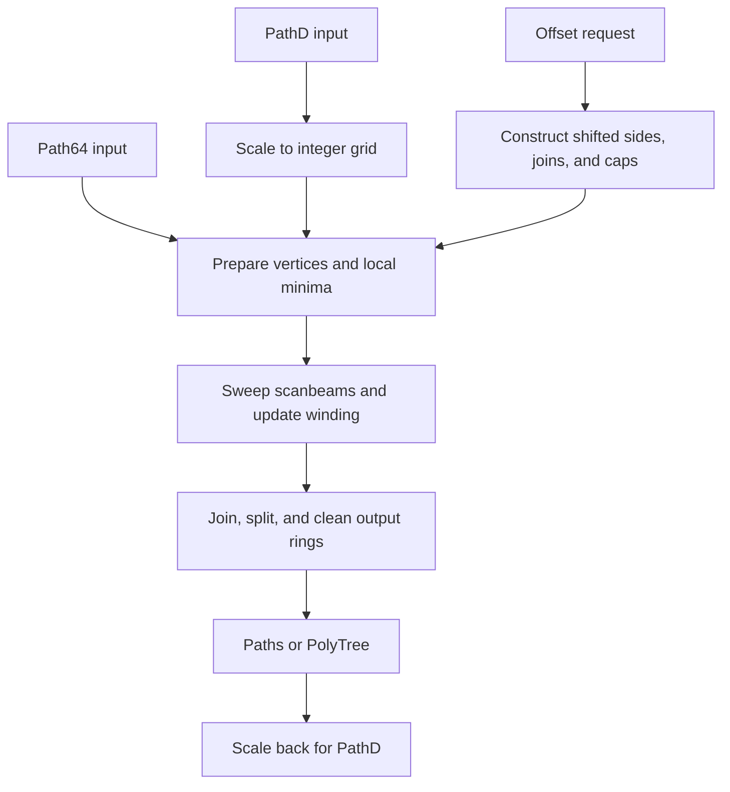

# Understanding Clipper2: from paths to the clipping engine

This guide explains the C# Clipper2 library in this repository: how to use it, how its geometry works, why the implementation is complicated, and how to investigate results without accidentally changing a design.

It is written for readers who can follow simple coordinate examples. You do not need a computational geometry background. The later chapters assume familiarity with the earlier ones.

The implementation discussed here is the managed port in [`Common/clipper`](.). Its upstream reference is [PolyClipping/Clipper2](https://github.com/PolyClipping/Clipper2), pinned to commit `884ba821abc002d895ce72dcc21fe139c207229f`. This repository preserves some established coordinate behavior for Variance and Quilt. Consequently, an upstream example and a default local call can differ. The compatibility chapter explains how to select the upstream behavior explicitly. See [the maintenance record](upstream/README.md) for what was ported and how the native reference fixtures are generated.

For source-level development, continue with the [novice-to-expert developer guide](DEVELOPER_GUIDE.md): it traces complete calls, explains linked state and object lifetimes, and connects the engine to DesignLibs application wrappers.

## How to read this guide

- **First use:** chapters 1–5 explain the data model, Boolean operations, fill rules, and precision.
- **Production use:** chapters 6–10 cover offsets, holes, open paths, metadata, and compatibility.
- **Understanding the engine:** chapters 11–14 explain the sweep, numerical decisions, output reconstruction, and performance.
- **Maintaining and debugging:** chapters 15–19 cover failure diagnosis, tests, source navigation, and the historical ideas behind the library.

You can work through the examples with the `clipper.csproj` project reference and `using Clipper2Lib;`. This project targets .NET 10 and enables `USINGZ` in every configuration.

## 1. What problem does Clipper solve?

Imagine drawing two filled rectangles on transparent sheets. You might want the part covered by both, everything covered by either, or the first rectangle with the second cut out. Clipper computes the boundaries of those regions.

Its main jobs are:

1. **Boolean operations:** intersection, union, difference, and exclusive-or.
2. **Offsets:** grow or shrink a filled boundary, or construct a filled stroke around a line.
3. **Rectangle clipping:** trim geometry to an axis-aligned rectangular window.
4. **Supporting operations:** area, containment, bounds, simplification, and Minkowski construction.

Clipper operates on straight segments. A curve must first be approximated by a sequence of segments. It does not interpret Bézier control points, circular arc commands, SVG transforms, or a CAD application's layer semantics.

The `Z` coordinate in this build carries metadata. It does **not** make Clipper a three-dimensional Boolean engine. All geometry decisions use X and Y.

A useful distinction is between **a boundary representation** and **the filled region it describes**. Two different lists of vertices can describe the same region. A clipping operation computes a region and then constructs a new boundary representation; it does not promise to preserve the input's vertex numbering or segmentation.

## 2. Points, paths, and regions

### The basic types

| Type | Meaning | Use it when |
|---|---|---|
| `Point64` | X/Y stored as signed 64-bit integers; Z metadata in this build | You already have grid coordinates or want explicit control of scaling |
| `Path64` | A list of `Point64` vertices | One boundary or one polyline |
| `Paths64` | A list of `Path64` objects | Multiple boundaries, holes, or disconnected objects |
| `PointD`, `PathD`, `PathsD` | Equivalent types with double X/Y coordinates | Your application uses physical units or fractional coordinates |
| `Rect64`, `RectD` | Axis-aligned bounds | View windows, quick rejection, and rectangle clipping |
| `PolyTree64`, `PolyTreeD` | A hierarchy of output boundaries | You need explicit parent/child relationships between outer boundaries and holes |

A path is not automatically a valid simple polygon. It can contain repeated points, collinear edges, crossings, or too few distinct vertices to enclose area.

### Closed versus open is a choice made by the operation

A closed path implicitly includes the segment from its last vertex to its first. You usually do not repeat the first vertex at the end:

```csharp
Path64 rectangle = Clipper.MakePath(new long[]
{
    0, 0, 100, 0, 100, 50, 0, 50
});
```

An open path has two endpoints and no implicit closing segment. Repeating the first vertex in a path does not replace the need to pass the correct open/closed setting. `AddOpenSubject`, `AddSubject`, and offset `EndType` communicate that setting.

A one-point path has no area. A two-point closed path also has no area. Offsetting can deliberately grow such paths into filled shapes; Boolean clipping normally cannot treat them as filled polygons.

### A hole is a relationship, not a special point-list type

A `Path64` does not contain an `IsHole` field. Whether it acts as a hole depends on the surrounding paths, the fill rule, and sometimes its direction. A tree makes those relationships explicit **after** the operation.

Keep related outer boundaries and holes together when performing operations. Treating every ring as an independent filled object can fill holes that were supposed to remain empty.

## 3. Your first Boolean operation

Here is a complete example using the instance API and upstream coordinate behavior:

```csharp
using System;
using Clipper2Lib;

Path64 a = Clipper.MakePath(new long[] { 0,0, 100,0, 100,100, 0,100 });
Path64 b = Clipper.MakePath(new long[] { 50,50, 150,50, 150,150, 50,150 });

var clipper = new Clipper64 { Compatibility = ClipperCompatibility.Upstream };
clipper.AddSubject(a);
clipper.AddClip(b);

var closed = new Paths64();
if (!clipper.Execute(ClipType.Intersection, FillRule.NonZero, closed))
    throw new InvalidOperationException("Clipping failed; do not use partial output.");

Console.WriteLine(Clipper.Area(closed)); // 2500
```

The intersection is the square from `(50,50)` to `(100,100)`. The two roles are named **subject** and **clip**:

| Operation | Region retained | Area in this example |
|---|---|---:|
| `Intersection` | Inside A and inside B | 2,500 |
| `Union` | Inside A or inside B | 17,500 |
| `Difference` | Inside A and outside B | 7,500 |
| `Xor` | Inside exactly one of A and B | 15,000 |

Difference is directional: `A − B` and `B − A` generally produce different shapes. Union, intersection, and XOR are mathematically symmetric, although path order and vertex representation need not be identical when operands are swapped.

For concise calls, the static facade provides `Clipper.Intersect`, `Union`, `Difference`, and `Xor`. These create a default instance internally, so they use the local **legacy compatibility default**. Use an instance when you need explicit compatibility, callbacks, open output, or engine settings.

Successful execution can return an empty result. Two disjoint rectangles have an empty intersection; that is a correct answer, not a failure.

## 4. Filling a boundary: parity, winding, and orientation

A boundary tells you where the edges are. A **fill rule** tells you which parts of the plane count as inside.

### EvenOdd: count crossings modulo two

Draw a ray from a point to a location outside the geometry. Count crossings of the boundary. An odd count means inside; an even count means outside. Vertex and horizontal-edge cases require a consistent crossing convention, discussed later.

Nested rings alternate between filled and empty under EvenOdd, regardless of direction. But duplicate identical rings cancel: crossing both changes parity twice.

### NonZero: retain the signed crossing count

Instead of just counting, assign opposite signs to crossings in opposite directions. The total is the **winding number**. An outer ring can contribute one turn, while a reversed inner ring subtracts that turn and creates a hole.

| Fill rule | A point is filled when its winding number `w` is… |
|---|---|
| `EvenOdd` | Odd |
| `NonZero` | Anything except zero |
| `Positive` | Greater than zero |
| `Negative` | Less than zero |

For two coincident rings wound the same way, the interior has winding magnitude two. NonZero keeps it; EvenOdd removes it. Reversing one of the rings makes their winding contributions cancel.

**Practical choice:** use the fill rule that matches the meaning of your source data. EvenOdd is useful for alternating nesting without reliable directions. NonZero is useful for consistently oriented outer/hole contours. Neither rule repairs a semantic mistake such as accidentally including the same filled object twice.

### Signed area and direction

For vertices `(xᵢ,yᵢ)`, the familiar shoelace formula is:

```text
signed area = 1/2 × Σ (xᵢ × yᵢ₊₁ − xᵢ₊₁ × yᵢ)
```

`Clipper.Area(path)` returns signed area; `Clipper.IsPositive(path)` reports its nonnegative direction convention. The square `(0,0), (100,0), (100,100), (0,100)` has positive area.

On a Cartesian graph with Y upward, that square goes counterclockwise. On a screen with Y downward, it appears clockwise. Say **positive** or **negative** when communicating with the code; a visual label such as “clockwise” needs a coordinate-system qualification.

For a normalized output region, summing signed areas subtracts holes from outers. Summing absolute areas instead adds the hole areas and can overstate material area. Conversely, taking the absolute value of the total can hide cancellation caused by inconsistent directions. Choose the calculation that matches the question.

A self-intersecting bow-tie can have zero signed area despite containing lobes under a fill rule. Zero signed area does not prove that every vertex lies on one straight line.

## 5. Precision: deciding what one integer means

### Why integers are central

Floating-point numbers approximate real values. Repeated geometric decisions around a crossing can disagree if each calculation loses a slightly different amount of precision. Integer coordinates provide a shared grid and exact comparisons for many predicates. This makes difficult arrangements more predictable.

This does not make the entire algorithm exact. Segment intersections generally have fractional coordinates, and the engine uses floating-point arithmetic for slopes and intersection calculations before returning points to the integer grid.

Think of the grid as part of your model, like a manufacturing resolution or a pixel pitch. Choose it deliberately.

### PathD still uses an integer clipping engine

`ClipperD` scales double coordinates into integer coordinates, clips there, and scales the answer back. Its decimal precision is restricted to `−8` through `8`.

At precision 4, one grid unit represents `0.0001` input units:

```text
application value 12.34567
    × 10,000
integer grid near 123,457
    ÷ 10,000 after clipping
application result 12.3457
```

The integer conversion rounds. Quantization occurs before clipping, and later intersections are also placed on that grid. The usual half-grid conversion error is not a bound on every derived quantity or on the topology of features narrower than a grid unit.

```csharp
var clipper = new ClipperD(4)
{
    Compatibility = ClipperCompatibility.Upstream
};
clipper.AddSubject(new PathD
{
    new(0, 0), new(1.25, 0), new(1.25, 2), new(0, 2)
});
var result = new PathsD();
bool ok = clipper.Execute(ClipType.Union, FillRule.NonZero, result);
```

An offset tolerance or distance passed directly to `ClipperOffset` is in integer-grid units. The `PathsD` `InflatePaths` facade scales its distance and arc tolerance for you.

### Range and useful precision are different limits

The core reserves arithmetic headroom: its coordinate limit is approximately `±(2^61 − 1)`. It cannot safely use the full signed 64-bit range for every operation because it must subtract coordinates and perform other intermediate calculations.

That limit is not a promise of uniform accuracy throughout the range. Floating intersection calculations lose useful accuracy as coordinate magnitudes approach and exceed roughly `10^15`. Every extra decimal place multiplies your scaled coordinates by ten.

Before choosing a scale, estimate:

1. The largest absolute coordinate after scaling.
2. The smallest feature or gap you must preserve.
3. The largest offset and intermediate extent you will create.
4. The number of operations that repeatedly round geometry.

For example, coordinates of size `10^8` with six fractional decimal places become `10^14` on the grid. Eight places become `10^16`, a much less comfortable range for intersections. More decimal places can make a computation less reliable if they push coordinates too high.

Where possible, subtract a common origin, scale, operate, and add the origin back. Translating geometry closer to zero reduces magnitude without changing its mathematical shape. Record the transform so every operand and result uses the same coordinate system.

### Do not “fix” every decision with an epsilon

An epsilon is appropriate when the application intentionally treats nearby physical points as equivalent. It is dangerous as a blanket replacement for geometric predicates. If A is near B and B is near C, A may still not be near C. An ordering based on such a rule can become inconsistent, breaking sorting and topology.

Use the library's exact integer predicates where available. Make application-level snapping an explicit preprocessing step with a documented tolerance.

## 6. Offsets: growth, erosion, and strokes

Boolean operations combine existing filled regions. Offsets construct new boundaries at a requested distance.

For a filled polygon:

- A positive delta expands outer boundaries and shrinks holes.
- A negative delta shrinks outer boundaries and expands holes.
- A narrow feature may disappear, split, or merge with another feature.

For an open path, offsetting constructs a filled stroke around the line. In this implementation, a nonzero constant delta is used by magnitude for open paths. Negative delta does not mean “remove the line.” The stroke has approximately twice the absolute delta as its full width.

```csharp
var offset = new ClipperOffset(miterLimit: 2, arcTolerance: 0.25)
{
    Compatibility = ClipperCompatibility.Upstream
};
offset.AddPath(
    Clipper.MakePath(new long[] { 0,0, 100,0, 100,100, 0,100 }),
    JoinType.Miter, EndType.Polygon);
var grown = new Paths64();
offset.Execute(10, grown);
// An axis-aligned square with miter joins grows from area 10,000 to 14,400.
```

### What happens at a corner?

Offsetting the two segments adjacent to a vertex produces two parallel shifted lines. How should they connect?

| Join type | Construction | Main tradeoff |
|---|---|---|
| `Miter` | Extend the shifted sides until they meet | Sharp corners; acute angles can produce long spikes |
| `Square` | Limit the corner using a square-style cut | Bounded extension, with a different footprint from a bevel |
| `Bevel` | Connect the shifted side endpoints directly | A simple clipped corner |
| `Round` | Insert a polygonal approximation to a circular arc | Smooth-looking corners at the cost of more vertices |

Miter growth depends on the corner angle. For an interior angle `θ`, the ideal miter length scales like `|delta| / sin(θ/2)`. As the angle gets very small, that length grows rapidly. `MiterLimit` bounds the permitted miter ratio; a corner beyond the limit falls back to a square-style construction.

### How should a path end?

| End type | Interpretation |
|---|---|
| `Polygon` | A filled closed boundary, including outer/hole relationships |
| `Joined` | A closed stroked line: join the ends, rather than treating the enclosed region as a filled polygon |
| `Butt` | An open stroke ending at the endpoint's perpendicular line |
| `Square` | An open stroke extending beyond each endpoint |
| `Round` | An open stroke with semicircular caps |

`Joined` and `Polygon` are different even when both close the path. A stroked closed loop can have an inner and outer boundary. A filled polygon has its own material interior before offsetting.

### Arc tolerance controls approximation, not the physical radius

For a circle of radius `r`, a chord spanning angle `α` has maximum radial deviation:

```text
error = r × (1 − cos(α/2))
```

Solving that relationship tells the library how many segments approximate a round join to the chosen tolerance. Smaller tolerance means more segments. In this port's upstream mode, the tolerance is bounded relative to radius and the step count is capped to avoid excessive segments that collapse onto the integer grid.

With the default zero arc tolerance, the library chooses an approximation relative to the radius. A zero tolerance does **not** request an exact circle.

### Concave corners explain why offsets end with a union

At an inward corner, blindly connecting shifted sides can create a loop or a reversed sliver. The offsetter deliberately builds intermediate paths that may self-intersect. A finishing union removes the regions with the wrong winding and reconstructs the intended filled result.

This is why an offset is more than moving each vertex along a normal. Its final stage is a clipping problem. It also explains why updating the clipping engine can change offset output even when no offset formula changes.

### Group related boundaries

Each `AddPaths` call creates an offset group with common join/end settings. The current algorithm uses 128-bit area accumulation to identify the largest closed path and determine the group's outer orientation. As upstream documents, this is exact when twice the final signed area fits in 127 bits; paths that wind around extremely many times can exceed that bound. It resolves containment between groups, recognizes holes and islands, and ignores holes that have no appropriate enclosing outer.

A disjoint negatively wound outer in its own group can still grow as an outer. A negatively wound path inside a larger positive outer can act as a hole. Those roles require both containment and direction; a negative sign alone does not universally mean “hole.”

For straightforward input, submit an outer and its holes together. Use separate groups when they have separate settings or when you intentionally depend on cross-group classification.

### Degenerate and tiny offsets

Empty paths are ignored. A point or flat line can grow under a positive polygon offset; a negative polygon delta erodes them away. A callback can grow only parts of a flat path; the offsetter retains the grown regions.

A constant offset smaller than half an integer-grid unit is treated as insignificant. Closed paths still pass through normalization/cleanup. Open paths have no useful width at that resolution and are dropped. Therefore, a zero offset is not a general-purpose identity or a deep-copy operation.

## 7. Getting explicit holes with PolyTree

A flat `Paths64` result contains boundaries but does not attach holes to particular parents. Use a `PolyTree64` when your next operation needs the nesting relationship.

```csharp
var clipper = new Clipper64 { Compatibility = ClipperCompatibility.Upstream };
clipper.AddSubject(new Paths64
{
    Clipper.MakePath(new long[] { 0,0, 100,0, 100,100, 0,100 }),
    Clipper.MakePath(new long[] { 25,25, 25,75, 75,75, 75,25 })
});
var tree = new PolyTree64();
var open = new Paths64();
bool ok = clipper.Execute(ClipType.Union, FillRule.NonZero, tree, open);
```

The tree root is a container, not a polygon. Its children are outer boundaries. Their children are holes; a hole's children are filled islands, and so on. `IsHole` describes that nesting parity. Check success before traversing the result.

`Clipper.PolyTreeToPaths64(tree)` flattens the tree. That is useful for rendering or another clipping operation, but it discards explicit ownership. Do not expect a later list index to identify the same hole.

A tree is not simply “every bounding box inside another bounding box.” Bounds provide quick rejection, but containment must also test geometry. A ring can fit inside the bounding box of an L-shaped polygon while lying in its empty notch.

## 8. Open-path clipping

Open paths are supported as **subjects**, not clips. Clip paths describe filled regions. Use the overload that returns both closed and open output:

```csharp
var clipper = new Clipper64 { Compatibility = ClipperCompatibility.Upstream };
clipper.AddOpenSubject(Clipper.MakePath(new long[] { -10,50, 110,50 }));
clipper.AddClip(Clipper.MakePath(new long[] { 0,0, 100,0, 100,100, 0,100 }));
var polygons = new Paths64();
var lines = new Paths64();
bool ok = clipper.Execute(ClipType.Intersection, FillRule.NonZero, polygons, lines);
```

This retains the line segment through the rectangle. It does not turn that line into a filled strip. Use offsetting for that.

An open path can split into several output paths when it enters and exits a filled region. Do not assume one output per input. The open part of union has different inclusion behavior from intersection: portions already covered by filled geometry do not need to remain as separate open output.

Segments lying exactly on a boundary are more subtle than a generic “inside or outside” rule. Contribution depends on surrounding edges, the operation, and whether the segment is entering or leaving a filled region. Preserve a minimal regression fixture for any boundary-overlap behavior your application relies on.

## 9. Metadata, Z callbacks, and object lifetime

### Z is attached data

This build retains `Point64.Z` and `PointD.z`. Existing vertices can carry identifiers, classifications, or other integer metadata. A newly constructed intersection has no universally correct inherited metadata: it lies on two source edges that may carry different values.

A Z callback supplies the application's policy:

```csharp
var clipper = new Clipper64 { Compatibility = ClipperCompatibility.Upstream };
clipper.ZCallback = (Point64 bot1, Point64 top1,
                    Point64 bot2, Point64 top2, ref Point64 hit) =>
{
    hit.Z = 42; // Replace with an application-specific provenance rule.
};
```

Callbacks receive the relevant segment endpoints. Their names reflect sweep orientation; they are not guaranteed to match the original vertex-list direction.

Set metadata in the callback. Do not move X/Y there: the engine has already used those coordinates to make ordering and connectivity decisions.

For `ClipperD`, the callback receives de-scaled double coordinates, and the Z metadata is copied back to the internal point. Do not assume it sees integer-grid coordinates.

Square and round offset vertices also need metadata propagation. The regression tests check that offset and clipping changes do not silently discard Z.

### Reuse and failures

A `Clipper64` or `ClipperD` instance can execute repeatedly on its added input. `Clear()` removes that input; execution cleanup normally removes only temporary solution state.

This managed port reports caught execution errors through a `false` return. A throwing Z callback is an example. Check the return value and discard partial output. The cleanup path still runs, so the instance can be reused after correcting the callback.

`ClipperOffset.Execute` has a different API: it returns `void`. Its callback exceptions are not converted into the Boolean execution contract. Avoid treating the two APIs as interchangeable error-handling models.

Instances are mutable and not designed for concurrent use. Use one instance per concurrent operation. The same applies to an output list while the engine is writing it. A reusable input container shares internal data; keep it alive and unchanged while a clipper uses that data.

## 10. Compatibility in this repository

Upstream no longer maintains the C# implementation. This repository maintains a port of its fixes while protecting existing consumers from known coordinate changes.

### Choosing a mode

| Setting | Default | What it controls |
|---|---|---|
| `Clipper64.Compatibility` / `ClipperD.Compatibility` | `Legacy` | Legacy truncation versus upstream rounded/canonicalized intersections, plus the differing right-edge join threshold |
| `ClipperOffset.Compatibility` | `Legacy` | Finishing-clip compatibility and established versus upstream square-join calculations |
| `ClipperOffset.PreserveInputOrientation` | Follows compatibility unless explicitly assigned | Legacy mode preserves the first polygon group's input direction; upstream mode defaults to positive outer output |
| `ReverseSolution` | `false` | Reverses the selected output direction |

For the upstream behavior:

```csharp
var clipper = new Clipper64 { Compatibility = ClipperCompatibility.Upstream };
var offset = new ClipperOffset { Compatibility = ClipperCompatibility.Upstream };
```

To retain input-oriented offset output while adopting upstream coordinate calculations:

```csharp
var offset = new ClipperOffset
{
    Compatibility = ClipperCompatibility.Upstream,
    PreserveInputOrientation = true
};
```

The static convenience methods create legacy-mode instances. There is no process-wide switch changing other consumers behind their backs.

Compatibility is **not** a frozen copy of every historical bug. Exact orientation predicates, cleanup, pooling, cyclic-split protection, and other fixes remain available. The mode preserves specifically identified behavior that affected existing application regressions.

### Migrate a workload, not just an API call

Before switching a production pipeline:

1. Record units, scale, fill rule, and current winding expectations.
2. Capture representative layouts, including narrow channels and touching boundaries.
3. Run the entire pipeline in each mode. A small upstream improvement at an early stage can affect later keyholing or decomposition.
4. Compare material area, connectivity, hole count, clearances, and domain-specific measurements.
5. Investigate coordinate changes instead of merely widening tolerances in tests.

All original library tests are retained. The separate upstream tests compare native C++ output with upstream-mode managed output. Passing one set does not substitute for the other.

## 11. The sweep-line engine: the central idea

Comparing every segment to every other segment wastes work. Most pairs never meet. A **sweep-line algorithm** processes geometry in coordinate order and maintains only the edges relevant to the current sweep position.

Clipper's engine is a scanbeam algorithm in the Vatti family. Picture a horizontal line moving through the drawing. The region between two consecutive event heights is a **scanbeam**. Edge crossings, vertex events, and horizontal segments determine what changes at its boundaries and inside it.

In this implementation, scanline Y values are processed from larger to smaller values. In common screen coordinates, that moves visually upward. Internal names such as `bot`, `top`, `LocalMin`, and `LocalMax` come from this convention; do not infer their numeric order from their everyday mathematical names.

### The preparation phase

Before clipping, the engine:

1. Links each input path's vertices.
2. Removes adjacent duplicate positions during construction.
3. Marks local extrema and open endpoints.
4. Splits a boundary conceptually into monotone **bounds** between extrema.
5. Sorts the local-minimum events by descending Y and then ascending X, preserving ties.

A bound is a sequence of edges that progresses from a starting extremum toward an ending extremum without reversing its vertical progression, apart from horizontal runs. A left and right bound can leave the same minimum.

### How the stages fit together



The offset branch feeds its provisional boundaries into a finishing union through the same engine. The diagram omits settings and callbacks so the shared geometry path is visible.

### The Active Edge List

At a given scanbeam, the **Active Edge List**, or AEL, holds edges currently crossing the sweep. It is linked left to right. An active edge records, among other things:

- Its bottom and top endpoints.
- Its X coordinate at the current sweep height.
- Its slope representation.
- Its subject/clip role and open/closed status.
- Its winding contributions.
- Its association with a partially built output boundary.

The ordering is not decorative. The regions between neighboring edges have winding counts, so the engine must know which edge is actually to the left of which.

### A simplified sweep loop

```text
prepare and sort local minima
choose the next event height
repeat:
    insert bounds beginning at this height
    process horizontal edges
    choose the next scanbeam top
    find the edge crossings needed to reach that top ordering
    process crossings from bottom to top
    advance edges reaching a vertex; finish edges at maxima
    process newly exposed horizontal edges
finish horizontal joins and reconstruct output
```

The real code handles interactions between those steps. The simplified loop gives you a map, not a replacement implementation.

### A rectangle example

For the two rectangles in chapter 3, the relevant Y heights are `150`, `100`, `50`, and `0`.

| Sweep interval | Active filled ranges | Intersection contribution |
|---|---|---|
| 150 down to 100 | B only | None |
| 100 down to 50 | A and B | X from 50 to 100 |
| 50 down to 0 | A only | None |

The resulting intersection has width 50 and height 50. More complicated polygons use the same principle, but the X positions change with Y and edges can exchange order between event heights.

## 12. What happens when edges meet?

### Winding counts turn geometry into Boolean decisions

Crossing a directed closed edge changes a winding count. The engine tracks counts for subject and clip geometry. From the selected fill rule, it derives whether each relevant region is inside subject and inside clip.

The Boolean operation then chooses whether that region belongs in the result. A boundary contributes when it separates a retained region from an unretained region.

This explains why a single edge cannot always be accepted or rejected in isolation. Its role depends on the edges around it and on winding accumulated from them.

### Finding intersections through ordering

The engine computes where active edges would lie at the scanbeam's top. If they remain in the same X order, there are no required order exchanges, and a sorting pass can be skipped.

Otherwise, a stable merge process finds the crossings needed to transform the lower ordering into the upper ordering. The **Sorted Edge List**, or SEL, supports this work separately from the AEL.

The intersection list is then sorted bottom to top, with X as the secondary coordinate and discovery order preserved for equal points. Before processing an event, the engine ensures the intersecting edges are adjacent in the AEL. It may reorder pending events to make that true.

Why adjacency? An edge cannot cross a distant edge in the left-to-right ordering without first crossing the intervening edges, unless several events coincide. Processing nonadjacent pairs arbitrarily would assign the wrong winding regions and connect output boundaries incorrectly.

### Why stable ordering matters

Several intersections can round to the same grid point. A generic unstable sort may reorder them differently on different runtimes. Although the point coordinates are equal, the sequence of edge exchanges can change which partial boundaries join.

Similarly, two edges leaving a shared vertex can have the same rounded X at the next scanline while actually heading in different directions. The engine compares their directions using exact cross-product signs and restores their order at the shared vertex.

These are examples of a general lesson: **equal rounded positions do not imply interchangeable topological events.**

### Horizontal edges are special

A horizontal segment does not cross a scanbeam in the same way as a sloping edge. Many vertices, overlapping segments, and extrema can share its Y coordinate. Its slope is represented specially, and it is processed along its horizontal span.

The engine must distinguish a boundary that merely touches another at the end of a horizontal run from one that continues across it. It also records horizontal segments for later joins and splits.

Treat horizontal processing as a separate subsystem when reading the code. Trying to explain it as “ordinary edges with slope zero” misses the event-ordering problem.

## 13. Robustness: predicates, constructions, and rounded topology

Computational geometry separates two kinds of work:

- A **predicate** asks a discrete question: left or right, parallel or not, inside or outside.
- A **construction** produces a coordinate: where two lines meet, or where an offset corner lands.

Predicates often control topology. A wrong left/right answer can join the wrong regions. A construction can still need rounding even when its surrounding predicates are exact.

### Exact orientation on the integer grid

For three points, the cross-product sign answers which side of a directed line the third point lies on:

```text
(b.x − a.x) × (c.y − b.y) − (b.y − a.y) × (c.x − b.x)
```

Evaluating those products as doubles can lose the sign when two large products nearly cancel. The managed port uses signed `Int128` product comparison for the integer predicate. It compares the products directly rather than subtracting two potentially large 128-bit products.

That is exact for the supported coordinate differences. It does not justify passing arbitrary full-range 64-bit endpoints whose differences overflow before multiplication.

### Intersection coordinates still need a grid policy

In the default C++ build, a parametric line calculation finds an intersection and constrains it to the first segment. Integer segments are evaluated in a canonical direction, and interior coordinates are rounded to the nearest integer with ties to even.

For example, `2.5` rounds to `2`, while `3.5` rounds to `4`. Constructors and other conversions do not necessarily use the same rounding convention. Do not substitute a generic point constructor for an explicitly rounded calculation without checking its semantics.

Legacy managed clipping used truncation in important intersection paths. For a very small region, a different rounded crossing can change both area and winding. That is why this port exposes a compatibility mode instead of silently assuming all rounding policies are equivalent.

### Clamping to the scanbeam

Nearly parallel lines can intersect far beyond the current scanbeam. Even a calculation constrained to a whole source segment may produce a point outside the current portion being processed.

The engine moves such intersections onto the appropriate scanbeam boundary or onto the flatter edge's segment **inside that scanbeam**. It then clamps the Y coordinate again to guard against a rounded projection overshooting at large magnitudes.

The constraint is an invariant: an event being processed in a scanbeam must not escape that scanbeam. Fixes here can prevent distant spikes or reversed slivers that look unrelated to the original numerical error.

### Why floating-point expression order matters

A processor can evaluate `a × b + c` as separate operations or as a fused multiply-add with a single rounding. Those answers can differ at a half-grid threshold. A one-unit difference in an intersection can change a tiny polygon's topology.

The native fixture generator disables floating-point contraction to match the pinned upstream arithmetic policy. The managed port uses ordinary separate arithmetic rather than introducing explicit fused multiply-add calls.

The upstream C++ optional `CLIPPER2_HI_PRECISION` build is a separate numerical variant. This managed port is checked against the **default** native build; it does not claim to implement that optional variant.

## 14. Building output boundaries and deciding ownership

The engine cannot append every result to a finished polygon immediately. During the sweep, two partial boundaries may later meet, one boundary may split into two, or a tentative contour may turn out to be a hole.

### OutPt and OutRec

`OutPt` objects form circular doubly linked lists of output points. A circular structure makes joining two rings or splitting one ring possible by reconnecting a few links instead of repeatedly copying large arrays.

An `OutRec` identifies a provisional output contour. It tracks its points, active front/back edges, ownership information, and later its built path and bounds.

At a local minimum, a new contour may begin. At a local maximum, two sides may close a contour or join two records. Intersections can exchange edge ownership and redirect how subsequent vertices are appended.

The output list is therefore a reconstruction of connectivity, not a simple trace of input polygon IDs.

### Cleanup is geometric, not just cosmetic

After joins and splits, the engine removes invalid small rings, duplicate positions, and collinear artifacts according to its rules. It also repairs certain self-intersections created by rounding.

`PreserveCollinear` keeps useful vertices along straight boundaries, but does not preserve every spike or every redundant point. A 180-degree reversal is different from a straight continuation and can be removed even when collinear preservation is enabled.

Very small triangles can be discarded to avoid unstable artifacts on the integer grid. If these triangles represent important physical features, the first question is whether your grid is fine enough.

### Ownership and cyclic splits

Determining which outer owns a hole is postponed until enough geometry is available. The engine checks bounds and containment and follows records created by earlier splits and joins.

An emptied record can still refer to split records. Those references can form a cycle. The cyclic-split guard marks records visited for the current ownership search before descending recursively. Without that guard, a rare layout can cause unbounded recursion rather than merely a wrong area.

### Accelerated containment

For repeated point tests against a large owner, `StripeIndex` partitions its edges into horizontal bands. A query visits only the edges assigned to the point's band.

The index:

- Stores edge endpoints as a snapshot.
- Uses exact integer cross-product signs for boundary tests.
- Uses a half-open crossing rule so a vertex is not counted twice.
- Declines indexing when tall edges would be duplicated across too many stripes.
- Falls back to the established containment path when an index is unsuitable or a nesting decision is ambiguous.

`PipIndexThreshold` on a clipper chooses when owner indexing is considered; its default is 64. Tests force both indexed and brute-force nesting and compare the results. It is a tuning/testing control, not a different fill rule.

The offset orientation code uses a packed bounds tree and lazily built edge indexes for a related purpose: quickly find candidate enclosing polygons, then perform real geometry tests.

## 15. Other tools and when to use them

### Rectangle clipping

`Clipper.RectClip` and `RectClipLines` use a specialized rectangular clipping implementation. When your clip region is an axis-aligned rectangle, this avoids the full general-polygon machinery.

Use the line version for polylines. A rectangular window does not change whether your source is a filled polygon or an open path.

### Point-in-polygon

`Clipper.PointInPolygon` returns `IsInside`, `IsOutside`, or `IsOn`. Always account for the boundary case explicitly. A point on a hole boundary may need a different application policy from a point strictly in material.

Despite an inherited `[Flags]` annotation on the enum, these results are alternatives; compare them as values. `IsOn` has numeric value zero, so treating the enum as a bit mask or a Boolean is especially misleading.

For many queries against a stable path, build a `StripeIndex` once and reuse it. If `Empty` is true, use `Clipper.PointInPolygon` as a fallback: the index can decline a path for performance reasons, not just because the polygon is empty. Rebuild after changing source geometry; the index is a snapshot.

### Simplification and trimming

`TrimCollinear` removes vertices on straight runs. `StripDuplicates` removes adjacent identical positions while preserving a singleton. `StripNearDuplicates` deliberately merges sufficiently close double positions.

`RamerDouglasPeucker` approximates a path by keeping vertices needed to satisfy its distance criterion. `SimplifyPath`/`SimplifyPaths` also reduce geometric detail using a tolerance.

These tools change representation, and tolerance-based simplification can change topology. A narrow channel can close, rings can touch, and nearby edges can cross. A union repairs the resulting fill according to a fill rule; it cannot recover information removed by simplification.

Do not confuse `Clipper.OffsetPath(path, dx, dy)`, which translates coordinates, with the offsetter that constructs parallel boundaries.

### Minkowski sums and differences

A Minkowski sum sweeps one shape over all positions in another. Conceptually, a sum contains every point `a + b` with `a` from one set and `b` from the other. This is useful for tool footprints, clearance envelopes, and configuration-space obstacles.

Round offsets are related to a Minkowski sum with a disk, but implementation details, polygonal approximations, and input interpretation matter. Do not assume every `Minkowski.Sum` call is interchangeable with every polygon offset.

### What is outside this library's scope?

This copy does not provide a current triangulation module. It also does not generate a medial axis, solve general 3D solids, preserve analytic curves, or attach application layer semantics to every output fragment. Other libraries in DesignLibs may build such functionality on top of Clipper's polygons.

## 16. Performance without sacrificing geometry

There is no useful universal promise that a Boolean operation takes `O(n log n)` independent of the geometry. The number of crossings, overlaps, output fragments, and nesting relationships can dominate work. Dense self-intersecting arrangements can have quadratically many candidate or actual interactions.

Before optimizing, measure separately:

1. Input preparation and scaling.
2. Clipping or offset construction.
3. Output reconstruction and nesting.
4. Downstream keyholing, decomposition, rendering, or serialization.

Practical improvements include:

- Keep a consistent grid throughout a pipeline to avoid repeated conversions and quantization.
- Remove adjacent duplicates and unnecessary detail when that does not change the required geometry.
- Use rectangle clipping for a rectangular window.
- Reuse a clipper for repeated operations on the same input; remember that `Clear` removes the input.
- Consider `ReuseableDataContainer64` when the same prepared geometry feeds several operations. Do not mutate it during use.
- Use flat output when you do not need ownership; use a tree when you do.
- Choose arc tolerance based on output needs, not an arbitrary extremely small value.
- Keep independent jobs on independent clipper instances.

The managed engine pools vertices, output records, output points, horizontal joins, and active edges. Pools reduce allocation pressure. They can retain capacity after a large operation; lower allocation count does not mean the instance will immediately return all memory to the operating system.

Native C++ uses arena allocation for related objects. The C# port uses managed pools to pursue the same allocation goal without importing native memory-lifetime rules. Equal output does not imply identical performance or memory usage.

Two recent optimizations exploit work already done: sorted local minima are merged with scanline events instead of all being requeued, and an intersection merge pass is skipped when active edges remain ordered. These optimizations are guarded by geometric invariants rather than by assumptions about typical shapes.

## 17. Debugging by symptom

| Symptom | Questions to ask first |
|---|---|
| Expected hole is filled | Was the fill rule correct? Were outer and hole supplied together? Was the hole reversed for NonZero? |
| Result unexpectedly empty | Did execution return false? Did winding cancel? Did quantization collapse the feature? |
| Small area difference | Did precision, intersection rounding, arc tolerance, or compatibility mode change? |
| Large spike | Are coordinates too large? Is an acute miter involved? Are near-parallel crossings escaping their scanbeam? |
| More polygons than expected | Did a narrow neck split? Did self-intersections or simplification change connectivity? |
| Fewer vertices | Were duplicate/collinear points removed? Did the result contain grid-scale triangles? |
| Same area but wrong design | Did a hole move, a bridge appear, or two regions exchange area? Compare geometry and connectivity. |
| Open line missing | Was it added as open subject? Are you reading the open output? Does it lie on a boundary? |
| Unexpected offset direction | Is it a polygon or a stroke? What is its group orientation? Is the caller assuming positive output? |
| Only a second execution fails | Are callbacks, output targets, or mutable inputs being reused incorrectly? Capture both executions. |
| Stack overflow in nesting | Reduce the case while preserving splits, holes, and ownership relationships. |

### A disciplined investigation

Record the exact input and settings before changing anything:

```text
coordinate units and common origin
scale / decimal precision
subject paths, open subjects, clip paths
operation and fill rule
compatibility mode
PreserveCollinear / ReverseSolution
join and end styles, offset delta, arc tolerance, miter limit
callbacks and expected metadata
actual output and success/failure status
```

Then draw subject, clip, and result in different colors. Label vertices near the failure. Inspect winding and local edge order, not just the overall silhouette.

Reduce the input by removing unrelated paths and vertices. Re-run after every reduction: a removed distant ring can change event ordering, so a visually simpler case may no longer reproduce the same defect.

Keep the smallest reproducer **and** the original application fixture. The small case explains the mechanism; the original catches downstream interactions that the small case no longer contains.

Avoid rounding a diagnostic dump more coarsely than the computation. A printout that hides the distinguishing decimal place can make different inputs appear identical.

## 18. Testing geometry well

A useful test suite has several kinds of evidence.

### Direct regression cases

Each fixed bug should have a case that would fail without the fix: a callback leaving stale state, a two-point offset changing later caps, a cycle in split ownership, or a clamped crossing producing a spike.

### Structural checks

Check success, nonempty valid contours where expected, tree nesting, hole direction, and the absence of unwanted zero-length or duplicate segments according to the output contract. Check Z values if provenance matters.

### Geometric checks

Area is necessary in many applications but insufficient alone. Two wrong shapes can have the same area. Compare region difference, clearances, bounding boxes, containment probes, and application-specific measurements.

When comparing polygon lists, ignore arbitrary ring starting vertices and list order if they are not part of the contract. Preserve winding during comparison; reversing every ring to make a test pass would conceal hole errors. Open-path endpoint direction may also matter to the application.

Our native-reference tests canonicalize the starting vertex of closed rings and sort the ring list. They retain every coordinate and its direction. They compare open paths with their vertex order preserved.

### Metamorphic tests

A metamorphic test relates several operations rather than relying on one stored answer. Examples:

- Swapping operands should preserve the region of intersection, union, or XOR.
- Reusing an instance should match a fresh instance with the same input and settings.
- Indexed nesting should match brute-force nesting.
- Reversing all rings under EvenOdd should preserve the filled region.
- Adding an empty path should not change an offset.

These are mathematical expectations interpreted on a finite grid. Exact serialized identity is sometimes too strong: repeated operations can round or reconstruct boundaries differently. Choose checks that expose meaningful errors without assuming an unsupported representation guarantee.

### Differential tests against upstream

The checked-in fixtures are generated by compiled native C++ at a pinned commit. They cover upstream's polygon and line corpus and an offset matrix over join types, end types, and positive/zero/negative deltas.

Native comparison answers “does this port match this upstream build on these inputs?” It does not prove correctness for all geometry, nor does it prove compatibility with an application's historical measurements. That is why the existing DesignLibs regressions remain separate and unchanged.

Run the library suite with:

```sh
dotnet test UnitTests/UnitTests.csproj -m:1
```

Run just the upstream comparisons and related regressions with:

```sh
dotnet test UnitTests/UnitTests.csproj -m:1 --filter FullyQualifiedName~ClipperUpstreamTests
```

Also run the consuming applications' tests when changing shared geometry. Record any pre-existing build or test failures separately; a partially failing application suite cannot certify a release merely because its geometry tests look healthy.

## 19. Reading and maintaining the implementation

### A source map

| File | What to look for |
|---|---|
| [`Clipper.cs`](Clipper.cs) | Public convenience operations, conversions, area, bounds, simplification, and tree flattening |
| [`Clipper.Core.cs`](Clipper.Core.cs) | Points, paths, rectangles, exact product comparison, segment intersection, and point-in-polygon |
| [`Clipper.Engine.cs`](Clipper.Engine.cs) | Vertices, active edges, winding, scanbeams, intersections, output records, ownership, and managed execution APIs |
| [`Clipper.Offset.cs`](Clipper.Offset.cs) | Offset groups, normals, corner/cap construction, orientation resolution, and finishing union |
| [`Clipper.RectClip.cs`](Clipper.RectClip.cs) | Specialized rectangle/path boundary processing |
| [`Clipper.Minkowski.cs`](Clipper.Minkowski.cs) | Minkowski construction and its cleanup |
| [`Clipper.Index.cs`](Clipper.Index.cs) | Y-stripe queries and bounds/edge indexes |
| [`PooledList.cs`](PooledList.cs) | Reusable storage and resetting pooled object state |
| [`Clipper.Helper.cs`](Clipper.Helper.cs) | Repository-specific helper functions |
| [`ClipperUpstreamTests.cs`](../../UnitTests/ClipperUpstreamTests.cs) | Native comparisons and focused migration regressions |

### A productive reading order

Start with a simple public call, then follow it through `ExecuteInternal`. Read `Reset`, local-minimum insertion, `DoIntersections`, and `DoTopOfScanbeam` before diving into horizontal joins. Next follow `AddOutPt`, `AddLocalMinPoly`, and `AddLocalMaxPoly` to understand output construction. Read ownership and `BuildTree` after the basic boundary lifecycle makes sense.

For offsets, follow `AddPaths` into `Group`, then `ExecuteInternal`, `DoGroupOffset`, `OffsetPoint`, the join methods, and the final clipper union. Keep the distinction between the requested `_delta` and per-group/per-callback `_groupDelta` visible. Accidentally overwriting requested delta is precisely the kind of state leak that makes later paths behave incorrectly.

When changing pooled objects, inspect both allocation and reset/clear paths. A new field initialized only in the constructor may work on the first execution and carry stale data on the second.

### Invariants worth writing down

- Local minima are consumed in the same order used to choose scanlines.
- The AEL reflects left-to-right geometric order at the relevant height.
- Edges processed at an intersection are adjacent when the event is applied.
- A scanbeam intersection remains within that scanbeam.
- Circular output rings have reciprocal `next`/`prev` links.
- Ownership searches terminate even when historical split records form cycles.
- Cached containment indexes correspond to finished, unchanged owner geometry.
- Every pooled record resets fields introduced by later changes.
- A temporary end-cap decision for one path does not change another path's interpretation.
- Compatibility settings are instance-local and propagate to finishing clipping operations.

A patch should explain which invariant it restores and include a test that exercises the failure. “The picture looks better” is useful evidence, but it is not enough to maintain an engine this interdependent.

### The ideas behind Clipper

Clipper builds on a long history of polygon processing rather than one isolated trick:

- **Scanline methods:** process a planar arrangement incrementally instead of comparing every possible pair up front.
- **Winding and crossing rules:** connect directed boundaries to filled regions, including self-intersections and holes.
- **Vatti's general polygon clipping approach:** supports general polygon arrangements through scanbeam processing and boundary reconstruction. Clipper belongs to this family; its current implementation contains substantial engineering beyond a short textbook presentation.
- **Robust geometric predicates:** protect discrete decisions from cancellation and inconsistent numerical answers.
- **Minkowski operations and mathematical morphology:** explain growth, erosion, and tool-footprint geometry.
- **Spatial indexing:** reject most candidates cheaply before expensive containment tests.
- **Allocation strategies:** make pointer-rich output construction practical for large arrangements.

Good further reading includes:

1. B. R. Vatti, **“A Generic Solution to Polygon Clipping,”** *Communications of the ACM*, 1992. [DOI: 10.1145/129902.129906](https://doi.org/10.1145/129902.129906).
2. Jonathan Richard Shewchuk, **“Adaptive Precision Floating-Point Arithmetic and Fast Robust Geometric Predicates,”** 1997. [Author's resources](https://www.cs.cmu.edu/~quake/robust.html). These explain robust predicates; the managed integer port here uses `Int128` comparisons rather than implementing that paper's complete floating expansion machinery.
3. David Goldberg, **“What Every Computer Scientist Should Know About Floating-Point Arithmetic,”** 1991. [Accessible reprint](https://docs.oracle.com/cd/E19957-01/806-3568/ncg_goldberg.html).
4. [The upstream Clipper2 wiki](https://github.com/PolyClipping/Clipper2/wiki), especially clipping, fill rules, robustness, offsetting, and trigonometry.
5. [Upstream source and regression tests at the pinned revision](https://github.com/PolyClipping/Clipper2/tree/884ba821abc002d895ce72dcc21fe139c207229f). The tests often explain why an apparently strange condition exists.

The most useful expert habit is to keep three questions distinct: **what region should this input mean, what region can this grid represent, and how does the engine preserve the connectivity of that region while processing events?** Most difficult Clipper problems become tractable once you identify which of those questions is actually failing.
